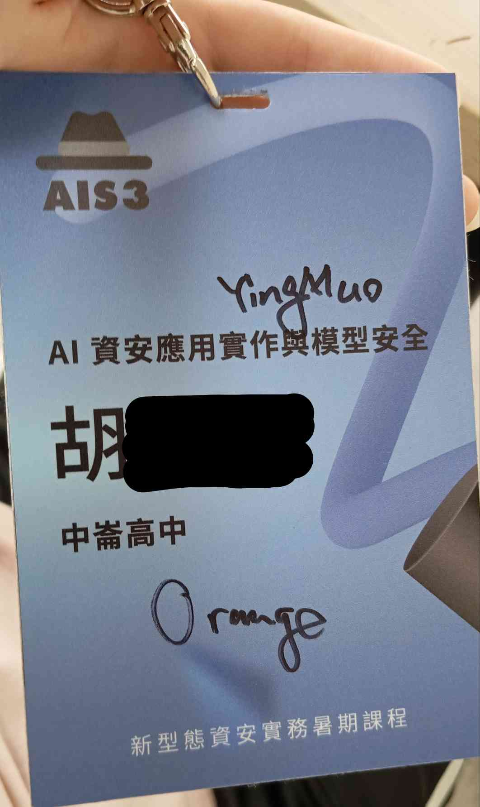

# AIS3 2026 心得  
> 文筆很爛QQ只是想記錄這七天  
### DAY0  
因為我覺得我第一天九點要到新竹一定是來不及，問過朋友都說會提早下去，就想說提早一天去搶床位  
在這裡感謝一下我媽陪我搭客運去交大還跟我爬了十幾分鐘好漢坡xD，總之一進交大就開始迷路了，我還跟一位大同大學的女生找了很久報到處在哪，最後還是我媽找到的笑死  
結果因為太晚到，我的兩位室友都已經搶好床了，所以我很主動選了跟電燈比較近的位置，但之後好像也才關三四次燈而已  
洗完澡後因為有一個室友是復興的，~~然後剛好我基本上跟復興玩資安都認識，所以他有問我要不要一起去清大夜市，結果我們去吃完豆花就走回宿舍了~~  
### DAY1  
印象比較深的有暗網跟安卓逆向，但體感偏簡單，不過在啟發興趣這塊難度捏得蠻好的  
跟組員還不太熟，但因為有組員是中山大學的所以淺羽滿照顧我們這組的  
btw 這次破冰不是以往的好玩題目，變宗教戰爭 Bingo 了，哭啊  
然後我是 Vim 派直接拯救我們組其它人xD  
通識課不錯玩，我更多在聽幹話，到底誰有辦法一次看 8 個 Agent 跑，超強
### DAY2
太陽的課蠻好玩的，然後兩位室友一致覺得 Mico 很帥  
通識課講真很好玩，雖然也有可能是因為我對 Networking 有點興趣，但超過我的認知負荷了QQ，沒辦法記全  
但最後 Kahoot! 第八，蠻有趣的  
### DAY3  
Pumpkin 的 Linux 存取控制幫我加強了不少基礎，挺有用的  
> 但聽說去年有 Linux Kernel Exploitation，我也想上QQ  

然後下午因為撞 AI 了不能去聽 VM 逃逸，超難過，雖然我人在國際會議廳但心在電腦教室  
吃完晚餐後就是聽 Orange 演講，聽的同時不禁思考：我以後有辦法成為跟 Orange 一樣強的人嗎？  
不誇張 Orange 真的整個人都在發光，羨慕了  
最後我有跑去跟 Orange 要簽名，然後 Orange 看到我的學校好像蠻訝異的  
~~我猜應該是因為我們學校不太有名~~  
~~要不是政附真的很遠我就跑去政附當 Orange 學妹了~~  
總之第三天蠻好玩蠻開心的，有符合我想要的 AIS3  
### DAY4
第四天的課都蠻中規中矩的，但校友之夜好玩，有大概去問過特選，還成為了戰隊訪客xD  
### DAY5
asef18766 的課蠻好玩的，但對不起我沒在看公告我沒先下載好，~~直接開啟手動大逆向時代~~  
吃完午餐後我去 CTF 的選修玩，我發誓我真的有先下載好 Mac 的壓縮檔，但C槽爆了...明年要帶 1TB 的 USB 去  
Apple Kernel 大概是我這五天覺得最有料的，恍神五秒就可以不用聽了xDD，但也因為這樣所以我全程都蠻專注的，總之好玩也大概符合我對 Kernel 的想像  
再來就是緊張刺激的抽專題了，結果我們直接抽到海軍陸戰隊，沒人玩 Reverse，但我們這組抽到了 AI 惡意程式逆向。  
> 其實後來發現這可能是相對好做的題目了，因禍得福xD  

然後我們整組都想不到要做什麼，我還被一個組員 PUA 說整組我最會手打 CTF，十分無助，反正一開始是想串工具加速動靜態分析  
### DAY6  
早上跟助教討論後決定嚴肅重想，然後淺羽也幫我們一起想，中午吃完飯後淺羽就跟我們說可以用 AI 迭代 Speakeasy，我們整組本來要死不活直接被淺羽奶活，~~淺羽是奶龍~~，謝謝淺羽  
### DAY7  
最後一天要退房，但我睡過頭了，~~我還有一些東西沒收完~~  
我直接彈跳起身十分鐘收完，嚇都嚇死  
總之就是討論 -> 工作 -> 結業 -> 回家  
在這邊謝謝我媽帶我回家沒叫我自己搭回台北  
然後附上勝利證明，我有 Orange 跟 Yingmuo 的簽名  
  

 