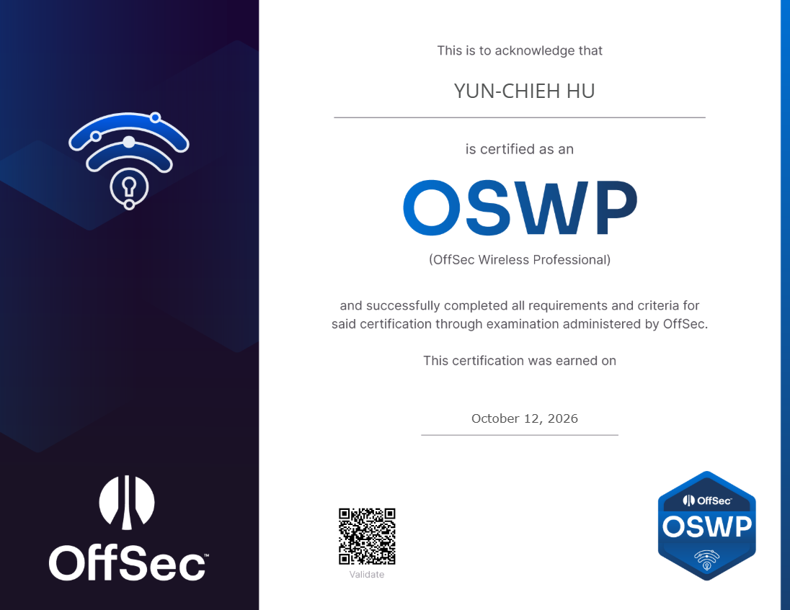

# OSWP review  
這門課程主要是教學一些無線網路的酷東西，從軟體設定到硬體確認應有盡有，唯一可惜的就是 OffSec 並沒有配置練習環境，要自己再去找找資源。  
### 前言  
會想寫這篇主要是我當初在找的時候蠻少看到 WP 的心得，我查 OSWP 出來的有一半會是 OSCP；四分之一是 OSEP。  
### 人權展示  
 
### 考試環境與事前準備 
詳細環境可以去看[OSCP失敗紀錄](https://chieh-212.github.io/blog/oscpfail/#%E8%80%83%E8%A9%A6%E7%92%B0%E5%A2%83%E8%88%87%E4%BA%8B%E5%89%8D%E6%BA%96%E5%82%99)  
準備的部分我是看完教材後利用 [WiFiChallengeLab](https://lab.wifichallenge.com/) 練習，基本上練完應該就可以過了，打個幾題就可以知道大致的流程  
還有看別人打 WiFiChallengeLab 的 [walkthrough](https://infosecwriteups.com/practical-study-material-oswp-part-1-wpa2-psk-walkthrough-cd4d869ae784)，~~因為我覺得看 Wireshark 很麻煩，他的打法可以直接用 tshark 看結果~~  
### 考試中  
OSWP 的配置是你必須拿 WPA-MGT + WPA-PSK or WEP 才可以通過考試，但很陰的是它機器預設會是 WPA-PSK，而且一次只能打一個場景  
我大概半小時才意識到這個問題，然後就 revert 鬼轉 MGT 了  
我大概花了一個小時完成 MGT 的大部分東西 ( 大概到架好 rogue AP )，然後我在機器沒有 wlan1 的問題卡了半小時，完全沒法 aireplay-ng 解除驗證  
亂戳之後我的 interface 有點死了，我就 revert 重打了  
結果後來架好 AP 上完廁所回來後發現我的 AP 被戳了，在半小時內結束 WPA-MGT 
然後再花半小時解決 WPA-PSK，截完圖就結束考試寫報告了  
### 總結  
OSWP 考試不難，但如果要純看教材的話可能會有些許難度，還是推薦大家可以自己找找網路上其他資源，就跟大家在準備 OSCP 一樣沒辦法只看教材就過  
然後至少要對流程有概念，因為過程非常制式化xD   